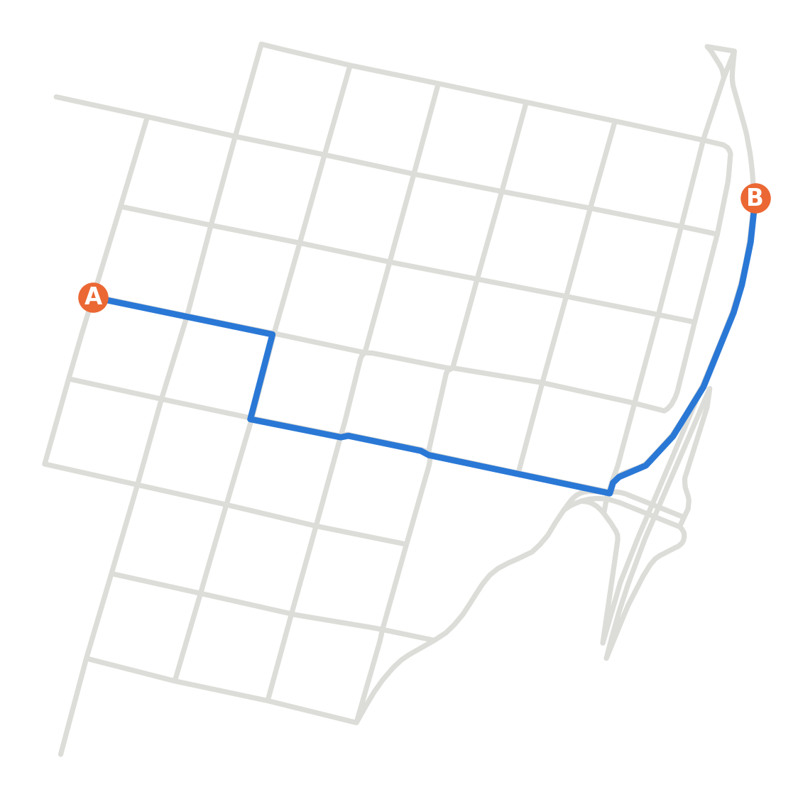
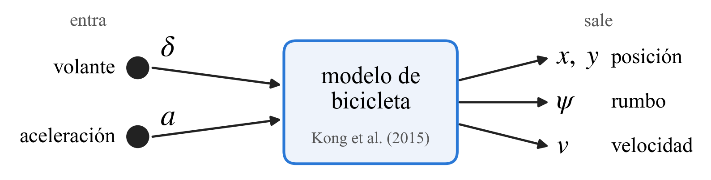
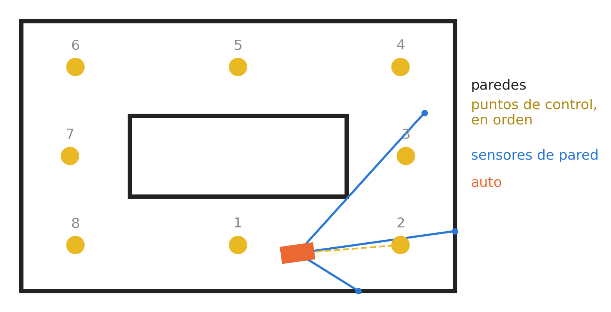
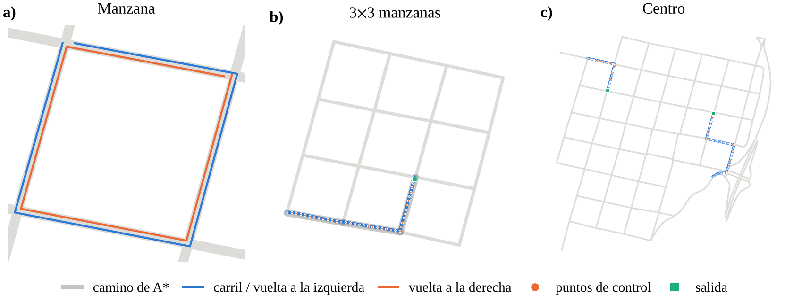
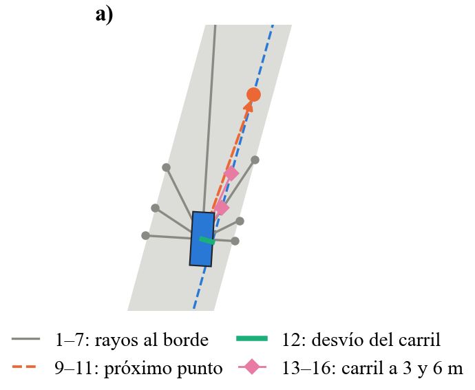
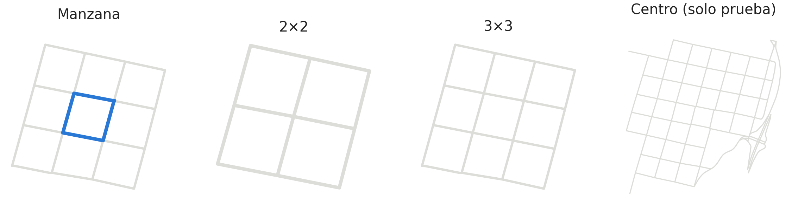

# La idea

## Conducción autónoma

:::: {.columns}
::: {.column width="50%"}
::: pregunta
¿Se le puede enseñar a un auto a manejar sin decirle cómo?
:::

Queremos que un auto vaya solo de **A** a **B** por calles reales de Santa Fe, sin salirse de la calle y por su carril.
:::
::: {.column width="50%"}
{width="88%"}
:::
::::

::: notes
Queremos que un auto vaya solo de A a B por calles reales de Santa Fe, sin salirse de la calle y por su carril. La pregunta es si se le puede enseñar a manejar sin decirle cómo.
:::

# Antecedentes

## ¿Cómo se mueve un auto, con las cuentas más simples?

:::: {.columns}
::: {.column width="36%"}
{width="100%"}

::: cita
Kong et al. (2015), fig. 1
:::
:::
::: {.column width="64%"}
{width="100%"}

- **Al modelo entran** las dos decisiones de quien maneja: volante y aceleración
- **Del modelo sale** dónde queda el auto: posición, rumbo y velocidad. Desde ahí, quien maneja vuelve a mirar y decide de nuevo
:::
::::

::: chico
Modelo cinemático de bicicleta (Kong et al., 2015): $\dot x = v\cos(\psi+\beta)$, $\dot y = v\sin(\psi+\beta)$, $\dot\psi = \frac{v}{\ell_r}\sin\beta$, $\dot v = a$, con $\beta = \arctan\!\left(\frac{\ell_r}{\ell_f+\ell_r}\tan\delta\right)$.
:::

::: notes
Para mover el auto usamos el modelo de bicicleta de Kong: junta las dos ruedas de cada eje en una. Lo usamos como una caja. Entran el volante y la aceleración, que es lo que va a decidir la red. Sale el estado del auto: la posición, el rumbo y la velocidad. Las ecuaciones son conocidas y están abajo, con la cita. Kong lo compara con datos de un auto real: predice casi tan bien como un modelo con neumáticos, con muchas menos cuentas.
:::

## ¿Se puede enseñar a manejar con un algoritmo evolutivo?

:::: {.columns}
::: {.column width="46%"}
{width="100%"}

::: cita
Togelius y Lucas (2005), p. 1911
:::
:::
::: {.column width="54%"}
- **Sí, sin ejemplos** (Floreano y Mondada, 1994; Togelius y Lucas, 2005): nadie le muestra a la red cómo manejar. Solo se elige, generación tras generación, la que más avanza
- **Con un perceptrón chico** (Togelius y Lucas, 2005): una capa oculta, que ve desde el auto la velocidad, las paredes y el próximo punto
- **Y sirve en pistas nuevas** (Togelius y Lucas, 2006): entrenada en unas, maneja en otras que nunca vio
- **Pero** son pistas de juguete con paredes: sin calles, sin carriles y sin esquinas
:::
::::

::: chico
Y no son los únicos: redes que hacen crecer su propia forma (NEAT, Stanley y Miikkulainen, 2002), autos de carrera que manejan mirando la pantalla (Koutník et al., 2013)… y la lista sigue.
:::

::: notes
Sí, y hace rato. Togelius y Lucas evolucionan redes que manejan autos de juguete simulados, sin darles ningún ejemplo de cómo manejar: en cada generación solo se quedan las redes que más avanzan. La red es un perceptrón multicapa con una capa oculta, dos salidas y tangente hiperbólica; la nuestra tiene la misma forma. Ve la velocidad, la distancia a las paredes y el ángulo al próximo punto de control, todo medido desde el auto. El fitness cuenta cuántos puntos de control pasó en orden. El algoritmo solo muta: 50 redes, cada una tiene un hijo mutado y de las 100 quedan las 50 mejores. Entrenan en unas pistas y prueban en otras, y siguen manejando. Pero son pistas de juguete con paredes: no hay calles, ni carriles, ni esquinas. Eso es lo que agregamos nosotros. Y no son los únicos: la neuroevolución se usa desde los 90 para robots y autos, y la lista de trabajos es larga.
:::

# Lo que proponemos

## Nuestras seis propuestas

1. **Calles reales de Santa Fe:** rutas de A a B, por el carril derecho
2. **Una red que mira el carril** 3 y 6 m adelante, además de los bordes y el próximo punto
3. **Un fitness que premia avanzar por su carril**
4. **Comparar** cuatro formas de cruzar y dos de mutar
5. **Entrenar por etapas:** de una manzana a mapas cada vez más grandes
6. **Un límite de agarre,** para que maneje como puede un auto real

::: notes
Esto es lo que proponemos, y es lo que vamos a contar. Manejar en calles reales de Santa Fe, de A a B y por su carril. Una red que, además de los bordes y el próximo punto, mira el carril 3 y 6 m adelante. Un fitness que premia avanzar por su carril. Comparar cuatro formas de cruzar y dos de mutar. Entrenar por etapas, de una manzana a mapas más grandes. Y un límite de agarre, para que el auto no pueda doblar a fondo a cualquier velocidad.
:::

## 1 · Calles reales, por su carril

{fig-align="center" width="48%"}

- **Calles reales de Santa Fe:** el camino más corto de A a B
- **Puntos de control** sobre el carril derecho
- **Un punto en cada giro,** para que no corte la esquina
- **Puntos que se pueden saltear,** para no quedar trabado

::: chico
Calles de OpenStreetMap, descargadas con OSMnx (Boeing, 2025). Camino más corto con A\* (Hart et al., 1968).
:::

::: notes
Usamos calles reales de OpenStreetMap, A* para elegir el camino y puntos de control sobre el carril derecho. Togelius manejaba en pistas de juguete con paredes, sin carriles y sin cruces de calles.

Para que doble bien: antes había un punto cada 15 m, repartidos sin mirar la forma de la ruta, y a veces la esquina quedaba entre dos puntos, lejos de los dos: el auto la cortaba y el fitness no se enteraba. Pasaba en el 11 % de los giros del 2×2, el 16 % del 3×3 y el 18 % del centro. Ahora el carril se corta en cada giro y se reparten puntos cada unos 10 m dentro de cada tramo. Además, dos entradas miran el carril 3 y 6 m adelante del auto, y los puntos se pueden saltear para no quedar trabado al abrirse en un giro.
:::

## 2 · La red: qué ve y qué decide

:::: {.columns}
::: {.column width="38%"}
{width="70%"}
:::
::: {.column width="62%"}
{width="88%"}
:::
::::

- **16 entradas**, medidas desde el auto: 7 rayos al borde, velocidad, próximo punto, desvío del carril y el carril 3 y 6 m adelante
- **2 salidas**, las que entran a la caja del modelo del auto: volante = 35° · o₁; acelerador 2 m/s² · o₂ si o₂ > 0, freno 4 m/s² · o₂ si no

::: notes
Lo que ve son 16 entradas: 7 rayos al borde de la calle, la velocidad, la dirección y la distancia al próximo punto de control, el desvío del carril y la dirección del carril 3 y 6 m adelante. Todo medido desde el auto, como en Togelius. Lo que decide son 2 salidas, que son las dos entradas de la caja del modelo del auto: el volante y la aceleración. La capa oculta tiene 16 neuronas, todas con tangente hiperbólica.
:::

## 3 · El fitness: avanzar por su carril

$$
F_r = (1-\lambda)\,\frac{k_r + p_r}{K_r}\,\bigl(1 - c\,f_r\bigr) + \lambda\,L_r\left(1 - \frac{t_r}{t_{\max,r}}\right)
$$

- **Avance:** los $k_r$ puntos de control pasados, más lo que avanzó hacia el siguiente ($p_r$), sobre el total $K_r$. Mide cuánto avanzó y no solo si llegó, porque al principio ninguna red llega y todas sacarían cero
- **Carril (lo nuestro):** se descuenta $c = 0{,}8$ por la fracción $f_r$ del tiempo que anduvo fuera de su carril
- **Tiempo:** premia llegar rápido, pero solo al que llega ($L_r = 1$). En nuestras corridas está apagado: **λ = 0**

::: chico
El fitness de la red es el promedio de sus rutas. El viaje termina si llega, si se sale de la calle o si se acaba el tiempo ($t_{\max,r}$ = largo de la ruta / 4 m/s + 10 s).
:::

::: notes
k son los puntos de control pasados; si el auto alcanza uno de los 2 siguientes al próximo, los que se salteó cuentan como pasados, así no queda trabado por abrirse en un giro. p es cuánto avanzó hacia el siguiente. K es el total de puntos: llegar a B vale 1. f es la fracción del tiempo fuera de su carril; se descuenta 0,8 y no 1 para que avanzar por la contramano valga algo más que quedarse quieto. Es el fitness de avance de Togelius con un descuento por carril. ¿Por qué no premiar solo llegar? Al principio ninguna red llega, todas sacan cero y no hay a quién elegir: Nelson et al. (2009) lo llaman bootstrap problem. Por eso el fitness mide cuánto avanzó, y algo de cómo se comportó: un fitness "a medida", en palabras de Nelson. El segundo término premia llegar rápido, pero solo al que llega: si no, chocar temprano daría premio. Su peso es λ; en nuestras corridas λ = 0, así que el fitness es solo avance y carril.
:::

## 4 · La red como cromosoma

{fig-align="center" width="78%"}

- **La red en fila:** 306 números reales, sin pasar a binario
- **¿Por qué un genético?** No hay un volante correcto en cada paso para la retropropagación: solo un fitness al final del viaje

::: notes
El cromosoma es la red en fila, como hacen Montana y Davis (1989), que entrenan así una red con un genético y les va mejor que con retropropagación. ¿Por qué no retropropagación? Necesita la respuesta correcta en cada paso y un fitness derivable. Al manejar no hay volante correcto, solo un fitness al final del viaje, y el fitness salta cuando el auto choca. El genético solo necesita saber qué red salió mejor. El cromosoma tiene 256 pesos de entrada a la capa oculta, 16 umbrales, 32 pesos a la salida y 2 umbrales. En total, 306 números reales. Los primeros 256 son la matriz de pesos leída fila por fila; cada neurona es una columna, así que sus pesos quedan salteados cada 16 genes. Por eso el cruce y la mutación por neurona eligen por columna, no por posición.
:::

## 4 · Las opciones que comparamos

**¿Por qué comparar?** Dos redes iguales con las neuronas en otro orden tienen cromosomas distintos: cruzadas peso por peso, el hijo puede no andar.

| Operador | Qué hace |
|---|---|
| Cruce por neurona | Cada neurona del hijo se copia entera de uno de los padres: sus pesos de entrada y su umbral |
| Cruce por pesos (uniforme) | Cada peso del hijo se copia del padre o de la madre, al azar, uno por uno |
| Cruce BLX-α | Cada peso se sortea entre los de los dos padres, con el intervalo agrandado α = 0,5 hacia cada lado |
| Sin cruce | El hijo es una copia de un padre; solo cambia por la mutación |
| Mutación gaussiana | Cada peso muta con probabilidad 0,05: se le suma un número normal de desvío σ |
| Mutación por neurona | Se eligen 2 neuronas y se les suma ruido normal a todos sus pesos de entrada y a su umbral |

::: chico
Con probabilidad 0,2 no hay cruce y el hijo es una copia de un padre, sea cual sea el tipo de cruce. El cruce por neurona no resuelve ese problema, porque empareja las neuronas por posición: solo evita desarmar cada neurona por dentro.
:::

::: notes
El problema de las permutaciones lo describe Yao (1999). Dos padres buenos pueden tener las neuronas en distinto orden; si se cruzan peso por peso, el hijo junta pedazos de neuronas distintas y puede no andar. Con 16 neuronas ocultas, la misma red se puede escribir de unas 1,4 · 10^18 formas. Por eso comparamos cuatro formas de cruzar y dos de mutar. El cruce por neurona, de Montana y Davis, copia neuronas enteras. Sin cruce, como Togelius, el problema casi no aparece. Con pesos reales, la mutación de siempre es la gaussiana: sumarle a cada peso un poco de ruido normal.
:::

## 5 · El algoritmo, etapa por etapa

{fig-align="center" width="100%"}

- **Ruido en el fitness:** cada red maneja solo 3 rutas al azar, así que la mejor de cada generación se confirma con 20 rutas fijas
- **La mejor red guardada** es la que llega en más rutas fijas; si empatan, la de mejor fitness, y después la más rápida

::: notes
Buscamos los 306 pesos de la red que dan el mejor fitness promedio en todas las rutas. Como no se pueden probar todas, cada red maneja 3 rutas al azar, más una de una etapa anterior. Eso le mete ruido al fitness; por eso la de mejor fitness de cada generación se confirma con 20 rutas fijas. Después, élite de 2, torneo de 3, cruce con probabilidad 0,8 y mutación con el σ de la etapa.
:::

## 5 · Las etapas

De lo fácil a lo difícil: la población arranca en una manzana y sube a mapas más grandes, sin reiniciarse.

{fig-align="center" width="80%"}

| Etapa | σ de la mutación | Pasa si la mejor llega en (desde la generación 10) | Generaciones |
|---|---|---|---|
| Manzana (vueltas a la del medio) | 0,3 | todas las rutas fijas | de 10 a 100 |
| 2×2 | 0,2 | el 90 % | de 10 a 50 |
| 3×3 | 0,15 | (última etapa) | 50 |

::: notes
Una tarea difícil se aprende mejor si se arranca por una fácil y se sube de a poco; lo vimos en Gomez y Miikkulainen (1996). La población arranca en la manzana, pasa al 2×2 y al 3×3, sin reiniciarse, y σ baja para afinar sin desarmar. El centro no es una etapa: queda para probar. Ojo: contiene a los recortes de entrenamiento, que son cerca del 22 % de sus calles; por eso también probamos en barrios que no se usaron para nada.
:::

## 5 · Así se ve entrenar

<video data-autoplay loop muted playsinline src="img/entrenamiento.mp4" style="width:88%; display:block; margin:0 auto"></video>

::: chico
Las 50 redes de una generación manejan a la vez la misma ruta. En azul, la de mejor fitness.
:::

::: notes
Esto es una corrida real, la misma de los resultados. En cada generación las 50 redes manejan la misma ruta a la vez; en azul la de mejor fitness, en gris el resto y en rojo las que chocan o se salen. En la manzana, al principio ninguna llega; a la generación 62 algunas ya dan la vuelta y pasan al 2×2. Ahí arrancan sabiendo algo, y en el 3×3 hacen rutas largas, con varias esquinas. Mostramos solo algunas generaciones de cada etapa, cada una en una ruta distinta. Los autos están dibujados más grandes que en la realidad, para que se vean.
:::

## 6 · El límite de agarre

- **El problema:** la primera versión llegaba rápido a las esquinas y se salía. El modelo del auto deja doblar a fondo a cualquier velocidad
- **El límite:** $a_y = v^2/R \le 6$ m/s². A más velocidad, menos volante. No frena: frenar antes lo tiene que aprender la red

{fig-align="center" width="64%"}

::: chico
Trayectorias sin y con límite (b) y volante máximo según la velocidad (c): por debajo de 5,1 m/s dobla a fondo; a 8 m/s, no pasa de 14,9°.
:::

::: notes
La primera versión llegaba rápido a las esquinas y se salía. En un cruce de calles de 7 m, la curva más amplia que entra tiene 17,9 m de radio doblando a la izquierda y 6,0 m a la derecha. Con 6 m/s² de aceleración lateral, eso da unos 37 km/h y unos 22 km/h; a 40 km/h no entra ninguna esquina. Pero el modelo de Kong deja doblar a fondo a cualquier velocidad, y eso ningún auto real lo puede hacer. Entonces limitamos la aceleración lateral a 6 m/s²: a cada velocidad hay un volante máximo. Con el modelo de Kong, R = l_r / sen β; despejando, sen β_max = a_max · l_r / v², y de ahí sale el volante máximo, con tope de 35°. Por debajo de 5,1 m/s se puede doblar a fondo; a 8 m/s, menos de 15°. El límite no frena: si llega rápido, se sale. Frenar antes lo tiene que aprender la red.
:::

# Resultados

## Tres preguntas

1. **¿Qué hace la red si la física no la limita?** Sin límite de agarre contra con límite de 6 m/s².
2. **¿Importa el operador?** Las seis opciones, una por vez.
3. **¿Maneja en calles donde nunca entrenó?** En el centro y en seis barrios que no se usaron para entrenar.

::: chico
Seis corridas: la base y cinco con un solo cambio. Una semilla. Se prueba con 20 rutas fijas, sin ruido en los sensores.
:::

::: notes
Tres preguntas, una por cada decisión: el límite de agarre, los operadores y si lo aprendido sirve en otro lado.
:::

## P1: sin el límite, la red hace trampa

:::: {.columns}
::: {.column width="36%"}
<video data-autoplay loop muted playsinline src="img/manejo_sin.mp4" style="width:100%"></video>
:::
::: {.column width="36%"}
<video data-autoplay loop muted playsinline src="img/manejo_con.mp4" style="width:100%"></video>
:::
::: {.column width="28%"}
**Sin límite:** dobla a 40 km/h, con 27,6 m/s²: casi 3 g.

**Con límite:** nunca pasa de 6,3 m/s².
:::
::::

::: chico
La red base (con límite) y la red sin límite, en la misma ruta del centro, a 4× del tiempo real.
:::

::: notes
Es la primera vez que se ve un auto entrenado. Sin límite dobla a 40 km/h, con 27,6 m/s² de aceleración lateral, casi 3 g. Con límite nunca pasa de 6,3 m/s².
:::

## P1 en números

| En el centro, 20 rutas | Llega | Tiempo medio | Velocidad cerca / lejos de un giro | Aceleración lateral máxima |
|---|---|---|---|---|
| Con límite | 15 / 20 | 111 s | 19 / 18 km/h | 6,3 m/s² |
| Sin límite | 20 / 20 | 56 s | 40 / 37 km/h | 27,6 m/s² |

- **Sin límite** llega siempre y en la mitad del tiempo, porque aprovecha una física imposible
- **Con límite** va lenta todo el viaje, no solo en las esquinas: como el fitness no premia el tiempo, ir lento no le cuesta nada
- La red aprende lo que el fitness le pide, y nada más

::: notes
Sin límite llega siempre y en la mitad del tiempo, porque aprovecha una física imposible. Con límite va lenta todo el viaje, no solo en las esquinas: como el fitness no premia el tiempo, ir lento no le cuesta nada. La red aprende lo que el fitness le pide, y nada más. En pruebas preliminares con premio por tiempo, una red aprendió a frenar antes de cada punto de control, no antes de cada giro: diseñar bien ese premio es lo que sigue.
:::

## P2 y P3: operadores y calles nuevas

| Qué cambia | Llega en el centro | Tiempo medio |
|---|---|---|
| nada (la base) | 15 / 20 | 111 s |
| cruce por pesos | 20 / 20 | 142 s |
| cruce BLX-α | 19 / 20 | 128 s |
| sin cruce | 19 / 20 | 135 s |
| mutación por neurona | 17 / 20 | 129 s |

- **P3:** todas aprendieron en la manzana, el 2×2 y el 3×3, y llegan en 15 a 20 de 20 rutas del centro, con diagonales, una avenida curva y cruces que no estaban en esos mapas
- **P2:** con una sola semilla, esas diferencias pueden ser suerte. Todos los operadores aprenden; para ordenarlos hacen falta más semillas

::: notes
Todas aprendieron en recortes chicos y manejan en el centro, que contiene a esos recortes pero suma diagonales, una avenida curva y un cruce de siete calles. Con una semilla no se pueden ordenar los operadores.
:::

## P3: cada red en un barrio que nunca vio

<video data-autoplay loop muted playsinline src="img/comparaciones.mp4" style="width:76%; display:block; margin:0 auto"></video>

::: chico
Abajo de cada red, cómo le fue en las 20 rutas fijas de su barrio. Los barrios son distintos: para comparar operadores está la tabla del centro.
:::

::: notes
Cada red, en un barrio que nunca vio. Todas manejan. Ojo: como cada una está en un barrio distinto, esto muestra que generalizan, no cuál operador es mejor.
:::

# Cierre

## Conclusiones

**Lo que propusimos:** entrenar por etapas, en calles reales, una red que maneja por su carril, con un límite de agarre que la obliga a manejar como un auto real.

1. Sin límite de agarre, la red aprovecha la física. Con el límite maneja dentro de lo posible, pero lento.
2. Todos los operadores aprenden; con una semilla no alcanza para ordenarlos.
3. Lo aprendido en recortes chicos sirve en el centro y en barrios que nunca vio.

::: chico
Lo que sigue: más semillas, premio por tiempo para que aprenda a frenar antes de las esquinas, tráfico y semáforos.
:::

::: notes
Propusimos entrenar por etapas, en calles reales de Santa Fe, una red que maneja por su carril, con un límite de agarre. Las redes manejan en calles que nunca vieron, y el límite las obliga a manejar dentro de lo que un auto real puede hacer.
:::
## Respaldo: los parámetros

| | Parámetro | Valor |
|---|---|---|
| Red | capas / desvío de pesos iniciales / ruido de sensores | 16 → 16 → 2 / 0,1 / 0,02 |
| Algoritmo genético | población / torneo / élite | 50 / 3 / 2 |
| | cruce / probabilidad | por neurona / 0,8 |
| | mutación / probabilidad por gen | gaussiana / 0,05 |
| | rutas por generación / fijas | 3 / 20 |
| Fitness | descuento por carril / premio por tiempo λ | 0,8 / 0 |
| Auto | límite de agarre | 6 m/s² |

::: notes
Los valores de la configuración de base.
:::
