# La idea

## Conducción autónoma

:::: {.columns}
::: {.column width="50%"}
::: pregunta
¿Se le puede enseñar a un auto a manejar sin decirle cómo?
:::

Queremos que un auto vaya solo de **A** a **B** por calles reales de Santa Fe, sin salirse de la calle y por su carril.
:::
::: {.column width="50%"}
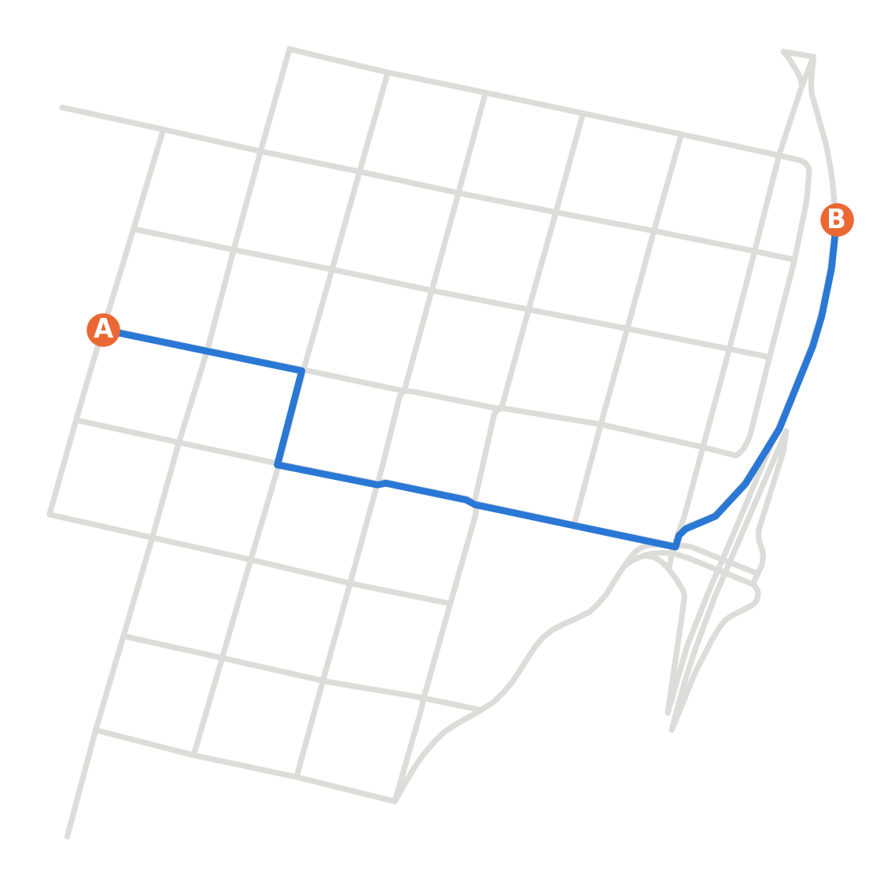{width="88%"}
:::
::::

::: notes
Queremos que un auto vaya solo de A a B por calles reales de Santa Fe, sin salirse de la calle y por su carril. La pregunta es si se le puede enseñar a manejar sin decirle cómo.
:::

# Antecedentes

## Antecedentes

De la cátedra traemos el **perceptrón multicapa** y el **algoritmo genético**. Lo demás lo sacamos de estos trabajos:

| Trabajo | La pregunta que responde |
|---|---|
| Kong et al. (2015) | ¿Cómo se mueve un auto, con las cuentas más simples? |
| Togelius y Lucas (2005, 2006) | ¿Se puede enseñar a manejar con un algoritmo evolutivo? |
| Montana y Davis (1989) | ¿Se puede entrenar una red con un algoritmo genético? |
| Yao (1999) | ¿Cómo se cruzan y se mutan las redes? |
| Nelson et al. (2009) | ¿Qué nota se le pone a un viaje? |
| Gomez y Miikkulainen (1996) | ¿Cómo se aprende algo difícil? |

::: notes
De la cátedra traemos el perceptrón multicapa y el algoritmo genético. Lo demás lo sacamos de estos seis trabajos; cada uno responde una pregunta que vamos a necesitar.
:::

## Kong et al. (2015)

::: pregunta
¿Cómo se mueve un auto, con las cuentas más simples?
:::

:::: {.columns}
::: {.column width="50%"}
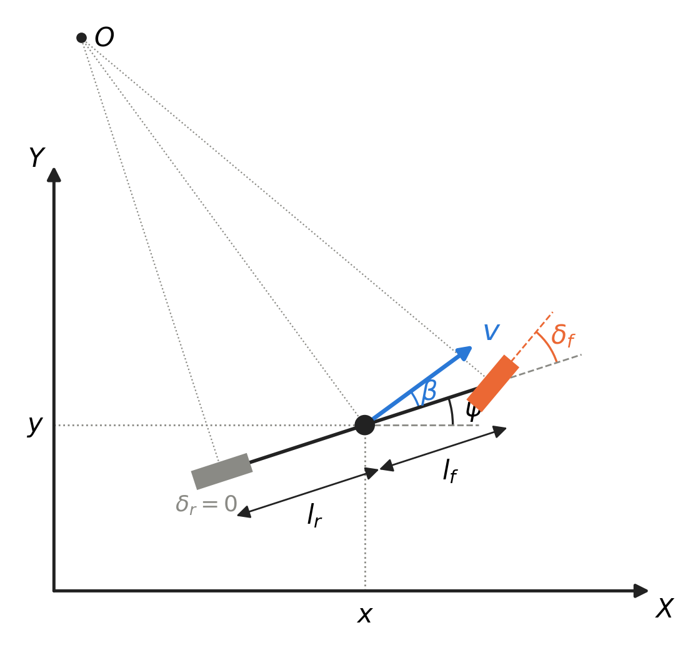{width="72%"}

::: cita
Kong et al. (2015), fig. 1
:::
:::
::: {.column width="50%"}
$$
\begin{aligned}
\dot x &= v\cos(\psi+\beta) \\
\dot y &= v\sin(\psi+\beta) \\
\dot \psi &= \frac{v}{l_r}\sin\beta \\
\dot v &= a \\
\beta &= \arctan\!\left(\frac{l_r}{l_f+l_r}\tan\delta_f\right)
\end{aligned}
$$

- Une las dos ruedas de cada eje
- **Estado:** posición, rumbo ψ y velocidad v
- **Entradas:** volante δ~f~ y aceleración a
:::
::::

::: notes
Junta las dos ruedas de cada eje en una. El estado es la posición, el rumbo y la velocidad. Tiene dos entradas, el volante y la aceleración: eso es lo que va a tener que decidir quien maneje, así que define las dos salidas de la red. Kong lo compara con datos de un auto real: predice casi tan bien como un modelo con neumáticos, con muchas menos cuentas.
:::

## Togelius y Lucas (2005, 2006)

::: pregunta
¿Se puede enseñar a manejar con un algoritmo evolutivo?
:::

:::: {.columns}
::: {.column width="50%"}
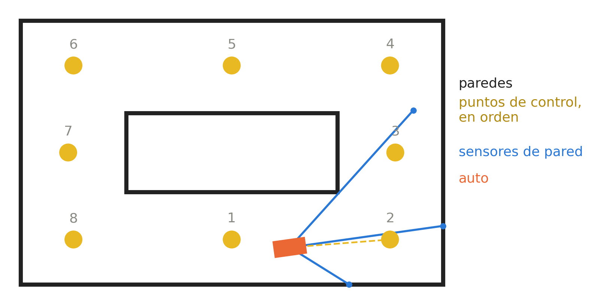{width="100%"}

::: cita
Togelius y Lucas (2006), figs. 1 y 2
:::
:::
::: {.column width="50%"}
- Autos de juguete, en pistas con paredes
- **Red:** una capa oculta (5 o 7), 2 salidas, tanh
- **Ve:** velocidad, paredes y próximo punto
- **Nota:** puntos de control pasados
- **Algoritmo:** estrategia evolutiva, solo mutación
- Entrenan en unas pistas, prueban en otras
:::
::::

::: notes
Evolucionan redes que manejan autos de juguete simulados. La red es un perceptrón multicapa con una capa oculta, dos salidas y tangente hiperbólica; en sus pruebas la capa oculta tiene 5 o 7 neuronas. Nuestra red tiene la misma forma. Ve la velocidad, la distancia a las paredes y el ángulo al próximo punto de control, todo medido desde el auto. La nota cuenta cuántos puntos de control pasó en orden. El algoritmo es una estrategia evolutiva que solo muta: 50 redes, cada una tiene un hijo mutado y de las 100 quedan las 50 mejores. Entrenan en unas pistas y prueban en otras.
:::

## Montana y Davis (1989)

::: pregunta
¿Se puede entrenar una red con un algoritmo genético?
:::

:::: {.columns}
::: {.column width="50%"}
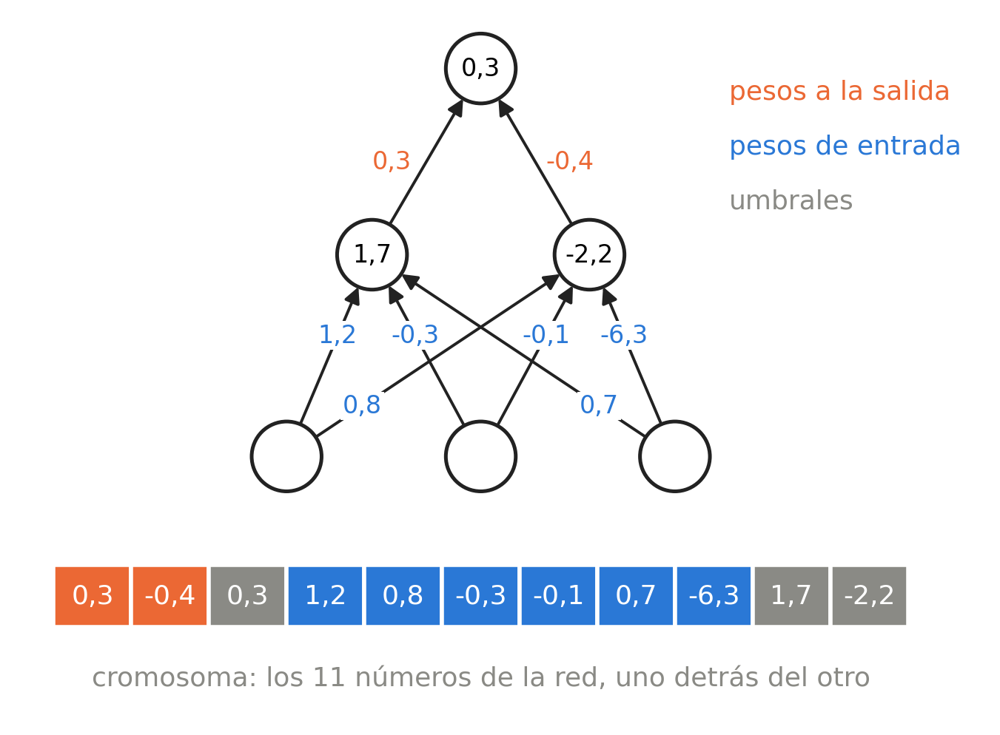{width="88%"}

::: cita
Montana y Davis (1989), fig. 1
:::
:::
::: {.column width="50%"}
- Los pesos en fila, como números reales: un cromosoma
- Con un genético les va mejor que con retropropagación
- **La retropropagación** necesita la respuesta correcta en cada paso y una nota derivable
- **Al manejar** solo hay una nota al final, y salta cuando el auto choca
- **El genético** solo compara qué red salió mejor
:::
::::

::: notes
Ponen todos los pesos de la red en fila, como números reales, y los buscan con un algoritmo genético. Les va mejor que con retropropagación. La razón: la retropropagación necesita la respuesta correcta en cada paso y una nota derivable. Al manejar no hay volante correcto, solo una nota al final del viaje, y la nota salta cuando el auto choca. El genético solo necesita saber qué red salió mejor.
:::

## Montana y Davis (1989): mutar y cruzar

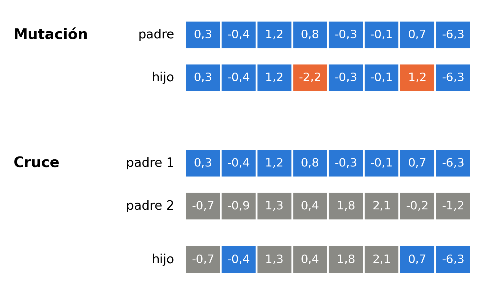{fig-align="center" width="58%"}

::: cita
Montana y Davis (1989), fig. 2
:::

La mutación cambia algunos genes de un padre. El cruce arma un hijo con genes de los dos padres, cada uno en su misma posición.

::: notes
Así operan sobre el cromosoma. La mutación cambia algunos genes de un padre. El cruce arma un hijo con genes de los dos padres, cada gen en su misma posición.
:::

## Yao (1999)

::: pregunta
¿Cómo se cruzan y se mutan las redes?
:::

:::: {.columns}
::: {.column width="50%"}
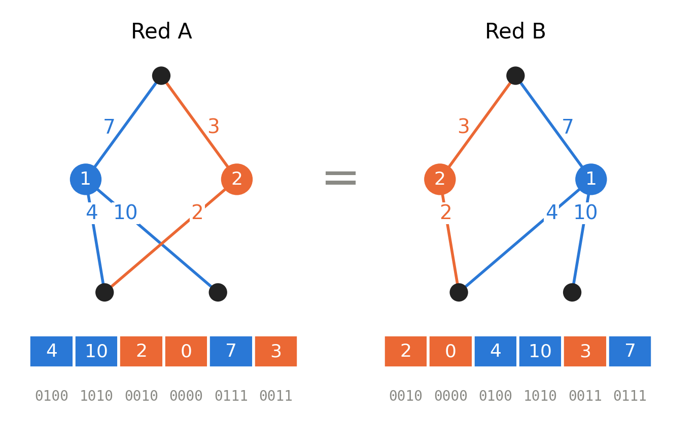{width="100%"}

::: cita
Yao (1999), figs. 3 y 4
:::
:::
::: {.column width="50%"}
- **Permutaciones:** dos redes iguales con las neuronas en otro orden tienen cromosomas distintos. Cruzadas peso por peso, el hijo puede no andar
- **Mutar:** con pesos reales, el operador principal es la mutación gaussiana
- **No cruzar:** solo mutar sufre menos este problema, como hace Togelius
- **Cruzar por neurona** (Montana y Davis): cada neurona del hijo viene completa de un padre
:::
::::

::: notes
Dos redes iguales pueden tener las neuronas en otro orden, y entonces sus cromosomas son distintos. Si se cruzan peso por peso, el hijo junta pedazos de neuronas distintas y puede no andar. Con pesos reales, el operador principal es la mutación gaussiana: sumarle a cada peso un poco de ruido normal. Los algoritmos que solo mutan sufren menos este problema; es lo que hace Togelius. Montana y Davis proponen cruzar neuronas enteras.
:::

## Las opciones que comparamos

| Operador | Qué hace |
|---|---|
| Cruce por neurona (Montana y Davis) | Cada neurona del hijo se copia entera de uno de los padres: sus pesos de entrada y su umbral |
| Cruce por pesos (uniforme) | Cada peso del hijo se copia del padre o de la madre, al azar, uno por uno |
| Cruce BLX-α (Eshelman y Schaffer, 1993) | Cada peso se sortea entre los de los dos padres, con el intervalo agrandado α = 0,5 hacia cada lado |
| Sin cruce (como Togelius) | El hijo es una copia de un padre; solo cambia por la mutación |
| Mutación gaussiana | Cada peso muta con probabilidad 0,05: se le suma un número normal de desvío σ |
| Mutación por neurona (Montana y Davis) | Se eligen 2 neuronas y se les suma ruido normal a todos sus pesos de entrada y a su umbral |

::: chico
Con probabilidad 0,2 no hay cruce y el hijo es una copia de un padre, sea cual sea el tipo de cruce.
:::

::: notes
De ahí salen las opciones que comparamos: cuatro formas de cruzar y dos de mutar.
:::

## Nelson et al. (2009)

::: pregunta
¿Qué nota se le pone a un viaje?
:::

:::: {.columns}
::: {.column width="50%"}
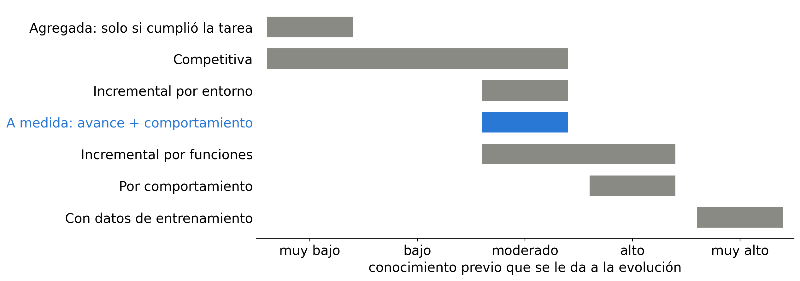{width="100%"}

::: cita
Nelson et al. (2009), tabla 1
:::
:::
::: {.column width="50%"}
- Ordenan las notas según cuánto le dicen a la evolución de antemano
- **Poco:** "llegó o no llegó". Al principio ninguna red llega y todas sacan cero: el *bootstrap problem*
- **Mucho:** premiar comportamientos puntuales le dice a la red cómo hacer la tarea
- **En el medio, "a medida":** cuánto avanzó y algo de cómo se comportó. Como la de Togelius
:::
::::

::: notes
Revisan las notas que se usan en robótica evolutiva y las ordenan según cuánto le dicen a la evolución de antemano. Con poco conocimiento, la nota "llegó o no llegó" deja que la evolución encuentre cualquier solución, pero al principio ninguna red llega, todas sacan cero y no hay a quién elegir: Nelson lo llama bootstrap problem. Con mucho conocimiento, una nota que premia comportamientos puntuales le dice a la red cómo hacer la tarea, y la limita a lo que el diseñador imaginó. En el medio está la nota "a medida": mide cuánto avanzó y algo de cómo se comportó. La de Togelius, por puntos de control, es de este tipo.
:::

## Gomez y Miikkulainen (1996)

::: pregunta
¿Cómo se aprende algo difícil?
:::

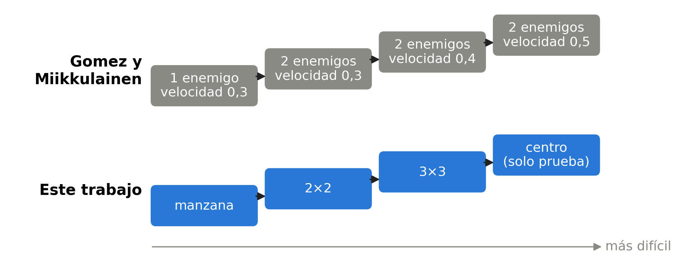{fig-align="center" width="70%"}

::: cita
Gomez y Miikkulainen (1996), sección 5.3
:::

Una tarea difícil se aprende mejor si se arranca por una fácil y se sube de a poco, sin reiniciar la población.

::: notes
Una tarea difícil se aprende mejor si se arranca por una fácil y se sube de a poco, sin reiniciar la población: primero escapar de un enemigo lento, después de dos, cada vez más rápidos.
:::

# Nuestro trabajo

## La red: qué ve y qué decide

:::: {.columns}
::: {.column width="38%"}
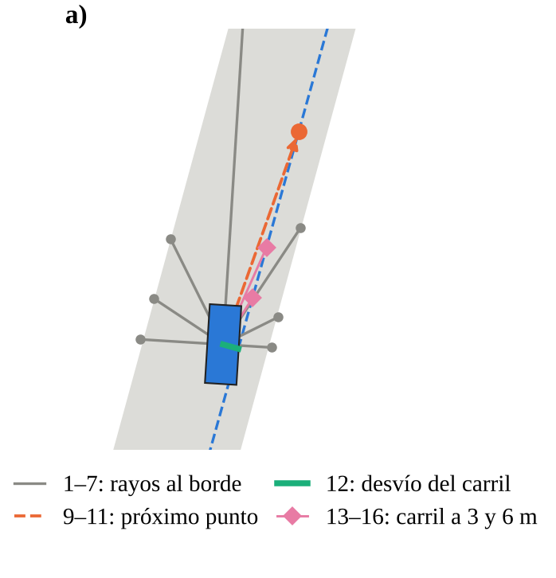{width="70%"}
:::
::: {.column width="62%"}
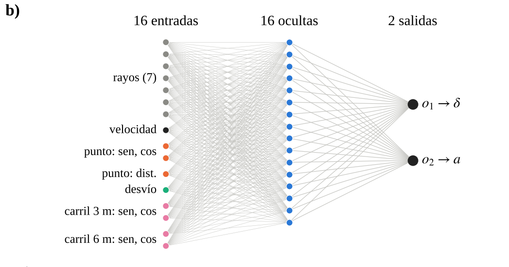{width="88%"}
:::
::::

- **16 entradas**, medidas desde el auto, como en Togelius: 7 rayos al borde, velocidad, próximo punto, desvío del carril y el carril 3 y 6 m adelante
- **2 salidas**, las entradas de Kong: volante = 35° · o₁; acelerador 2 m/s² · o₂ si o₂ > 0, freno 4 m/s² · o₂ si no

::: notes
Lo que ve son 16 entradas: 7 rayos al borde de la calle, la velocidad, la dirección y la distancia al próximo punto de control, el desvío del carril y la dirección del carril 3 y 6 m adelante. Todo medido desde el auto, como en Togelius. Lo que decide son 2 salidas, que son las dos entradas del modelo de Kong. La capa oculta tiene 16 neuronas, todas con tangente hiperbólica.
:::

## La red como cromosoma

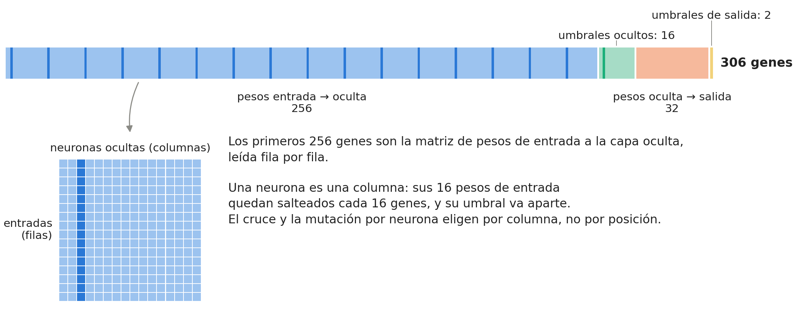{fig-align="center" width="100%"}

La red en fila, como Montana y Davis: 306 números reales, sin pasar a binario.

::: notes
El cromosoma es la red en fila, como Montana y Davis: 256 pesos de entrada a la capa oculta, 16 umbrales, 32 pesos a la salida y 2 umbrales. En total, 306 números reales. Los primeros 256 son la matriz de pesos leída fila por fila; cada neurona es una columna, así que sus pesos quedan salteados cada 16 genes. Por eso el cruce y la mutación por neurona eligen por columna, no por posición.
:::

## Las permutaciones en nuestra red

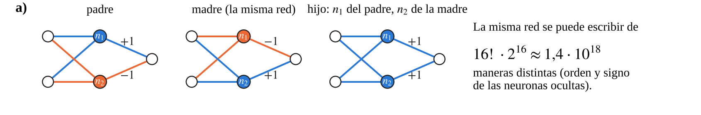{fig-align="center" width="100%"}

- Nuestra red se puede escribir de 16! · 2^16^ ≈ 1,4 · 10^18^ formas distintas: el orden y el signo de las 16 neuronas ocultas
- El cruce por neurona no lo resuelve, porque empareja las neuronas por posición: solo evita desarmar cada neurona por dentro

::: notes
Dos padres buenos pueden tener las neuronas en distinto orden. Con 16 neuronas ocultas, la misma red se puede escribir de unas 1,4 · 10^18 formas. El cruce por neurona no lo arregla: solo evita desarmar cada neurona por dentro.
:::

## Nuestra nota

$$
F_r = (1-\lambda)\,\frac{k_r + p_r}{K_r}\,\bigl(1 - c\,f_r\bigr) + \lambda\,L_r\left(1 - \frac{t_r}{t_{\max,r}}\right)
$$

:::: {.columns .arriba}
::: {.column width="50%"}
- **Avance:** $k_r$ puntos de control pasados, más $p_r$, el avance hacia el siguiente, sobre el total $K_r$
- **Carril:** $f_r$, fracción del tiempo fuera de su carril, con descuento $c = 0{,}8$
- **Tiempo:** $L_r$ vale 1 si llegó; $t_r$ es lo que tardó. Solo premia al que llega
:::
::: {.column width="50%"}
- En nuestras corridas **λ = 0**: el premio por tiempo está apagado
- La nota de la red es el promedio de sus rutas
- La nota de Togelius con un descuento por carril: "a medida", según Nelson
:::
::::

::: chico
El viaje termina si llega, si se sale de la calle o si se acaba el tiempo ($t_{\max,r}$ = largo de la ruta / 4 m/s + 10 s). Si alcanza uno de los 2 puntos siguientes al próximo, los que se salteó cuentan como pasados.
:::

::: notes
k son los puntos de control pasados; si el auto alcanza uno de los 2 siguientes al próximo, los que se salteó cuentan como pasados, así no queda trabado por abrirse en un giro. p es cuánto avanzó hacia el siguiente. K es el total de puntos: llegar a B vale 1. f es la fracción del tiempo fuera de su carril; se descuenta 0,8 y no 1 para que avanzar por la contramano valga algo más que quedarse quieto. Es la nota de avance de Togelius con un descuento por carril: una nota "a medida", en palabras de Nelson. El segundo término premia llegar rápido, pero solo al que llega: si no, chocar temprano daría premio. Su peso es λ; en nuestras corridas λ = 0, así que la nota es solo avance y carril.
:::

## Qué buscamos

Buscamos los pesos de la red que den la mejor nota promedio en todas las rutas. Como no podemos probarlas todas al entrenar, usamos 3 rutas al azar. Esto hace que la nota sea inestable, que tenga **ruido**: depende de qué rutas salgan sorteadas. Lo resolvemos confirmando la mejor red con 20 rutas fijas.

$$
\mathbf{w}^\ast = \arg\max_{\mathbf{w}} J(\mathbf{w}), \qquad J(\mathbf{w}) = \text{promedio de } F_r(\mathbf{w}) \text{ sobre todas las rutas}
$$

::: chico
$\mathbf{w}$: los 306 pesos de la red. $F_r(\mathbf{w})$: la nota que saca en la ruta $r$. Cada generación son 50 · 3 + 20 = 170 viajes simulados.
:::

::: notes
Buscamos los 306 pesos que dan la mejor nota promedio en todas las rutas. Como no se pueden probar todas, cada red maneja 3 rutas al azar, y eso le mete ruido a la nota: la misma red saca notas distintas según qué rutas le tocan. Por eso, en el algoritmo, la mejor se confirma con 20 rutas fijas.
:::

## Nuestro algoritmo

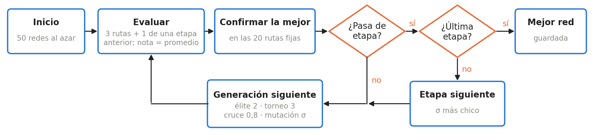{fig-align="center" width="100%"}

- **La mejor red guardada** es la que llega en más rutas fijas; si empatan, la de mejor nota, y después la más rápida
- **Pasa de etapa** si la mejor llega en el 90 % de las rutas fijas (en la manzana, en todas) después de al menos 10 generaciones, o si se acaban las generaciones

::: notes
Buscamos los 306 pesos de la red que dan la mejor nota promedio en todas las rutas. Como no se pueden probar todas, cada red maneja 3 rutas al azar, más una de una etapa anterior. Eso le mete ruido a la nota; por eso la de mejor nota de cada generación se confirma con 20 rutas fijas. Después, élite de 2, torneo de 3, cruce con probabilidad 0,8 y mutación con el σ de la etapa.
:::

## Nuestras etapas

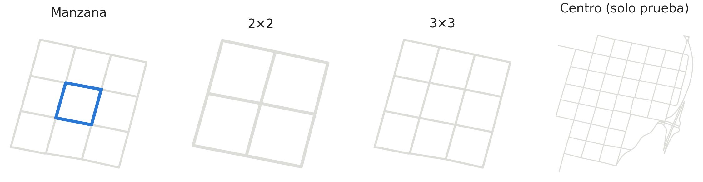{fig-align="center" width="94%"}

| Etapa | σ de la mutación | Pasa si la mejor llega en | Generaciones |
|---|---|---|---|
| Manzana (vueltas a la del medio) | 0,3 | todas las rutas fijas | de 10 a 100 |
| 2×2 | 0,2 | el 90 % | de 10 a 50 |
| 3×3 | 0,15 | (última etapa) | 50 |

::: notes
Como Gomez, de lo fácil a lo difícil. La población arranca en la manzana, pasa al 2×2 y al 3×3, sin reiniciarse, y σ baja para afinar sin desarmar. El centro no es una etapa: queda para probar. Ojo: contiene a los recortes de entrenamiento, que son cerca del 22 % de sus calles; por eso también probamos en barrios que no se usaron para nada.
:::

## Los parámetros

| | Parámetro | Valor |
|---|---|---|
| Red | capas / desvío de pesos iniciales / ruido de sensores | 16 → 16 → 2 / 0,1 / 0,02 |
| Algoritmo genético | población / torneo / élite | 50 / 3 / 2 |
| | cruce / probabilidad | por neurona / 0,8 |
| | mutación / probabilidad por gen | gaussiana / 0,05 |
| | rutas por generación / fijas | 3 / 20 |
| Nota | descuento por carril / premio por tiempo λ | 0,8 / 0 |
| Auto | límite de agarre | 6 m/s² |

::: notes
Los valores de la configuración de base.
:::

## Lo que agregamos

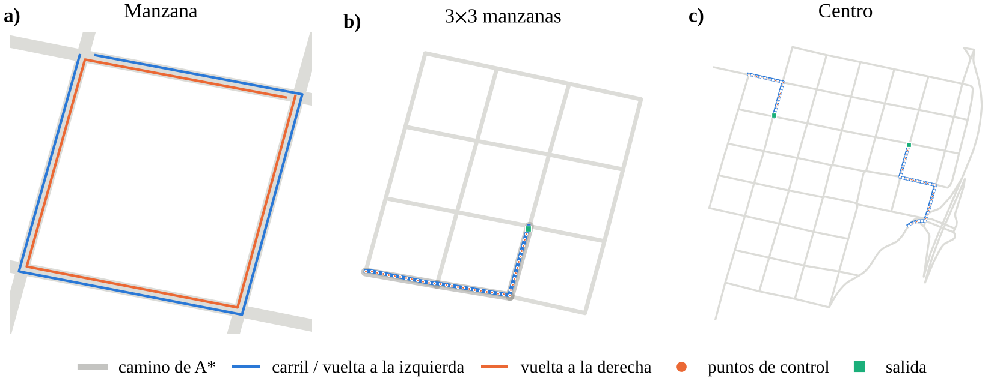{fig-align="center" width="62%"}

- **Calles reales** de OpenStreetMap; A\* elige el camino; puntos de control sobre el carril derecho
- **Un descuento en la nota** por andar fuera del carril

::: chico
Togelius maneja en pistas de juguete con paredes, sin carriles y siempre en el mismo circuito. El modelo de Kong supone que las ruedas nunca patinan.
:::

::: notes
Lo que no tenían los antecedentes: Togelius maneja en pistas de juguete con paredes, sin carriles y siempre en el mismo circuito. El modelo de Kong supone que las ruedas nunca patinan: deja doblar a fondo a cualquier velocidad. Nosotros usamos calles reales de OpenStreetMap, A* para elegir el camino y puntos de control sobre el carril derecho, con un descuento en la nota por andar fuera del carril. Y cuatro cambios para que doble bien.
:::

## Para que doble bien: la esquina y el agarre

:::: {.columns}
::: {.column width="44%"}
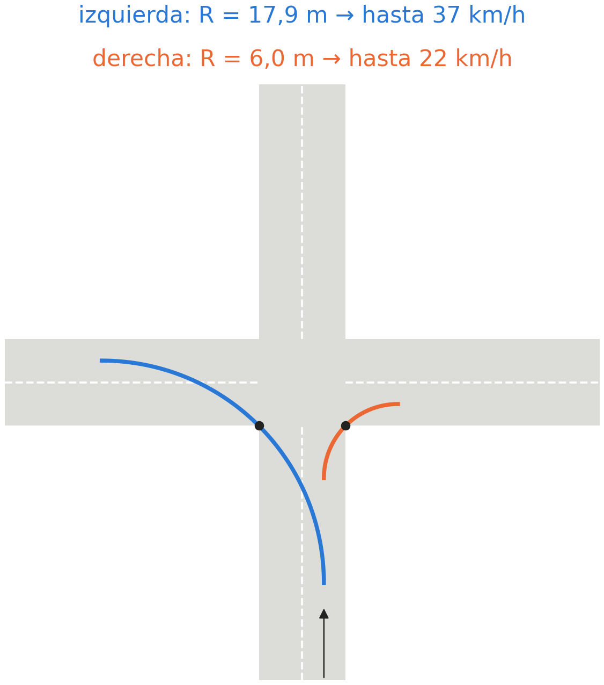{width="90%"}
:::
::: {.column width="56%"}
- **El problema:** la primera versión doblaba mal, sobre todo a la derecha, la curva más cerrada
- **En una esquina** de calles de 7 m, la curva más amplia tiene 17,9 m a la izquierda y 6,0 m a la derecha: con 6 m/s², hasta 37 y 22 km/h. A 40 km/h no entra ninguna
- **Límite de agarre:** Kong deja doblar a fondo a cualquier velocidad. Ahora la aceleración lateral no pasa de 6 m/s²: a más velocidad, menos volante
- **El límite no frena:** si llega rápido, se sale. Frenar antes lo tiene que aprender la red
:::
::::

::: notes
La primera versión doblaba mal, sobre todo a la derecha, que es la curva más cerrada: llegaba rápido a la esquina y se salía. En un cruce de calles de 7 m, la curva más amplia que entra tiene 17,9 m de radio doblando a la izquierda y 6,0 m a la derecha. Con 6 m/s² de aceleración lateral, eso da unos 37 km/h y unos 22 km/h. A 40 km/h no entra ninguna esquina. La red sin límite aprovechaba el modelo de Kong: doblaba a 40 km/h con 27,6 m/s², casi 3 g; un auto real patina cerca de 8 m/s².
:::

## El límite de agarre, en cuentas

$$a_y = \frac{v^2}{R} \le a_{\max}, \qquad R = \frac{\ell_r}{\sin\beta}$$

$$\sin\beta_{\max} = \frac{a_{\max}\,\ell_r}{v^2}, \qquad \delta_{\max}(v) = \min\!\left(35^\circ,\ \arctan\!\left(\frac{\ell_f+\ell_r}{\ell_r}\tan\beta_{\max}\right)\right)$$

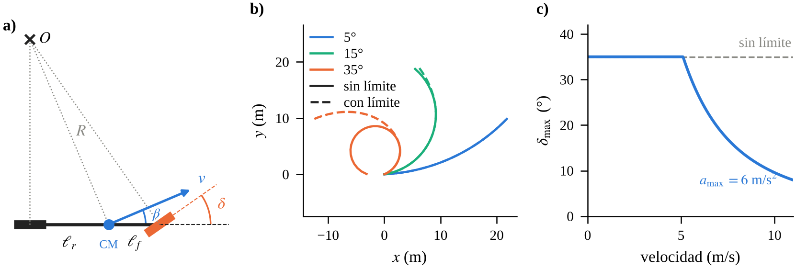{fig-align="center" width="70%"}

::: chico
Con 6 m/s²: por debajo de 5,1 m/s el auto puede doblar a fondo; a 8 m/s el volante queda limitado a 14,9°. (b) sin y con límite; (c) el volante máximo según la velocidad.
:::

::: notes
La aceleración lateral es v al cuadrado sobre el radio, y en el modelo de Kong el radio es l_r sobre el seno de beta. Despejando, a cada velocidad hay un volante máximo. Por debajo de 5,1 m/s se puede doblar a fondo; a 8 m/s, menos de 15°.
:::

## Para que doble bien: los puntos y la mirada

- **Puntos de control en cada giro.** Antes había uno cada 15 m sin mirar la forma de la ruta, y a veces la esquina quedaba entre dos puntos: el auto la cortaba y la nota no se enteraba. Pasaba en el 11 % de los giros del 2×2, el 16 % del 3×3 y el 18 % del centro. Ahora hay uno cada 10 m y siempre uno justo en el giro
- **Mirar el carril adelante.** El próximo punto, a hasta 15 m, en una esquina quedaba en diagonal y no decía cómo era la curva. Dos entradas miran el carril 3 y 6 m adelante: hacia dónde va y cuánto dobla
- **Puntos que se pueden saltear.** Si al abrirse en un giro alcanza uno de los 2 puntos siguientes, los salteados cuentan como pasados y no queda trabado

::: chico
Falta confirmar cuándo y por qué se agregaron los puntos salteables: están en el código, pero no en el apunte.
:::

::: notes
Antes había un punto cada 15 m, repartidos sin mirar la forma de la ruta, y a veces la esquina quedaba entre dos puntos, lejos de los dos. Ahora el carril se corta en cada giro y se reparten puntos cada unos 10 m dentro de cada tramo. Además, dos entradas miran el carril 3 y 6 m adelante del auto, y los puntos se pueden saltear para no quedar trabado al abrirse en un giro.
:::

# Resultados

## Tres preguntas

1. **¿Qué hace la red si la física no la limita?** Sin límite de agarre contra con límite de 6 m/s².
2. **¿Importa el operador?** Las seis opciones, una por vez.
3. **¿Maneja en calles donde nunca entrenó?** Todas se prueban en el centro, que no es una etapa y es más difícil que los mapas de entrenamiento, y en seis barrios que no se usaron para entrenar: 20 rutas fijas en cada uno, sin ruido en los sensores.

::: chico
Seis corridas: la base (cruce por neurona, mutación gaussiana, con agarre) y cinco con un solo cambio. Etapas: manzana (hasta 100 generaciones) → 2×2 (hasta 50) → 3×3 (50). Población de 50, una semilla.
:::

::: notes
Tres preguntas, una por cada decisión: el límite de agarre, los operadores y si lo aprendido sirve en otro lado.
:::

## P1: sin el límite, la red hace trampa

:::: {.columns}
::: {.column width="36%"}
<video data-autoplay loop muted playsinline src="img/manejo_sin.mp4" style="width:100%"></video>
:::
::: {.column width="36%"}
<video data-autoplay loop muted playsinline src="img/manejo_con.mp4" style="width:100%"></video>
:::
::: {.column width="28%"}
**Sin límite:** dobla a 40 km/h, con 27,6 m/s²: casi 3 g.

**Con límite:** nunca pasa de 6,3 m/s².
:::
::::

::: chico
La red base (con límite) y la red sin límite, en la misma ruta del centro, a 4× del tiempo real.
:::

::: notes
Es la primera vez que se ve un auto entrenado. Sin límite dobla a 40 km/h, con 27,6 m/s² de aceleración lateral, casi 3 g. Con límite nunca pasa de 6,3 m/s².
:::

## P1 en números

| En el centro, 20 rutas | Llega | Tiempo medio | Velocidad cerca / lejos de un giro | Aceleración lateral máxima |
|---|---|---|---|---|
| Con límite | 15 / 20 | 111 s | 19 / 18 km/h | 6,3 m/s² |
| Sin límite | 20 / 20 | 56 s | 40 / 37 km/h | 27,6 m/s² |

- **Sin límite** llega siempre y en la mitad del tiempo, porque aprovecha una física imposible
- **Con límite** va lenta todo el viaje, no solo en las esquinas: como la nota no premia el tiempo, ir lento no le cuesta nada
- La red aprende lo que la nota le pide, y nada más

::: notes
Sin límite llega siempre y en la mitad del tiempo, porque aprovecha una física imposible. Con límite va lenta todo el viaje, no solo en las esquinas: como la nota no premia el tiempo, ir lento no le cuesta nada. La red aprende lo que la nota le pide, y nada más.
:::

## P1: velocidad y aceleración lateral en la ruta

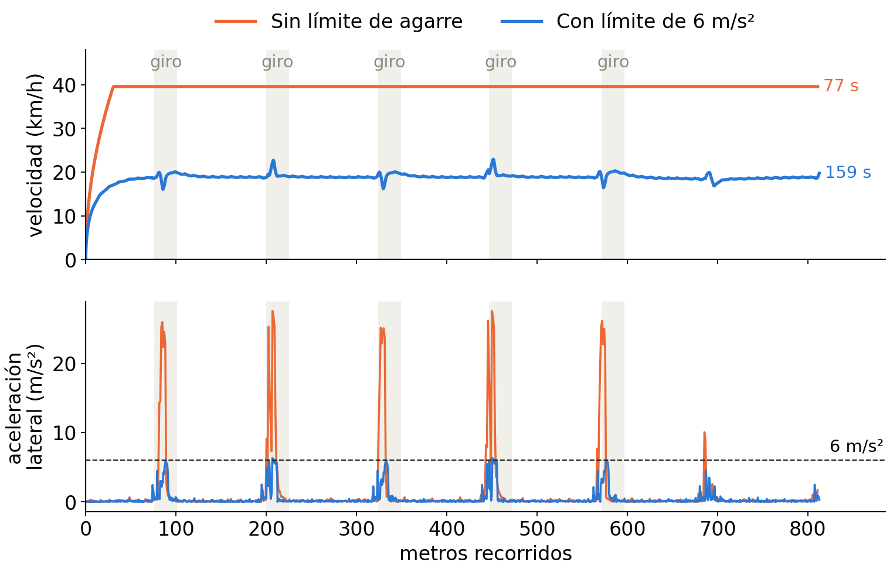{fig-align="center" width="58%"}

::: chico
La misma ruta de los videos. En pruebas preliminares con premio por tiempo (λ = 0,1), una de dos redes aprendió a bajar la velocidad antes de cada giro.
:::

::: notes
Arriba, la velocidad; abajo, la aceleración lateral, con los giros marcados. Sin límite va a 40 km/h todo el viaje y en cada giro llega a 25 o 27 m/s². Con límite va a unos 19 km/h todo el viaje y nunca pasa de los 6 m/s²: no frena en las esquinas, va lenta siempre. En pruebas preliminares con premio por tiempo, una de dos redes sí aprendió a bajar la velocidad antes de cada giro: frenar es posible, pero esta nota no lo pide.
:::

## P2 y P3: operadores y calles nuevas

| Corrida | Qué cambia | Llega en el centro | Tiempo medio |
|---|---|---|---|
| 4743 | nada (la base) | 15 / 20 | 111 s |
| 9082 | cruce por pesos | 20 / 20 | 142 s |
| 8477 | cruce BLX-α | 19 / 20 | 128 s |
| 3623 | sin cruce | 19 / 20 | 135 s |
| 9009 | mutación por neurona | 17 / 20 | 129 s |

- **P3:** todas aprendieron en la manzana, el 2×2 y el 3×3, y llegan en 15 a 20 de 20 rutas del centro, con diagonales, una avenida curva y cruces que no estaban en esos mapas
- **P2:** con una sola semilla, esas diferencias pueden ser suerte. Todos los operadores aprenden; para ordenarlos hacen falta más semillas

::: notes
Todas aprendieron en recortes chicos y manejan en el centro, que contiene a esos recortes pero suma diagonales, una avenida curva y cruces de más de cuatro calles. Con una semilla no se pueden ordenar los operadores.
:::

## P3: cada red en un barrio que nunca vio

<video data-autoplay loop muted playsinline src="img/comparaciones.mp4" style="width:76%; display:block; margin:0 auto"></video>

::: chico
Abajo de cada red, cómo le fue en las 20 rutas fijas de su barrio. Los barrios son distintos: para comparar operadores está la tabla del centro.
:::

::: notes
Cada red, en un barrio que nunca vio. Todas manejan; en los barrios más difíciles, como La Guardia o Arenales, chocan más. Ojo: como cada una está en un barrio distinto, esto muestra que generalizan, no cuál operador es mejor.
:::

# Cierre

## Conclusiones

1. Sin límite de agarre, la red aprovecha la física. Con el límite maneja dentro de lo posible, pero lento.
2. Todos los operadores aprenden; con una semilla no alcanza para ordenarlos.
3. Lo aprendido en recortes chicos sirve en el centro.

**Lo nuestro:** juntar las piezas de estos trabajos en calles reales, agregar el límite de agarre y medir qué aporta cada una.

::: chico
Lo que sigue: más semillas, premio por tiempo para que aprenda a frenar antes de las esquinas, tráfico y semáforos.
:::

::: notes
Lo nuestro fue juntar las piezas de estos trabajos en calles reales, agregar el límite de agarre y medir qué aporta cada una.
:::
