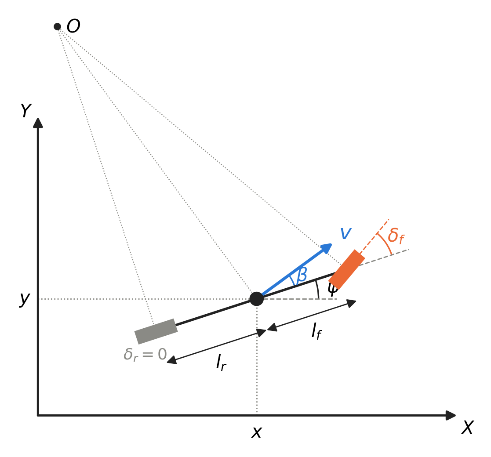
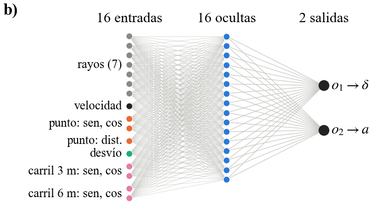
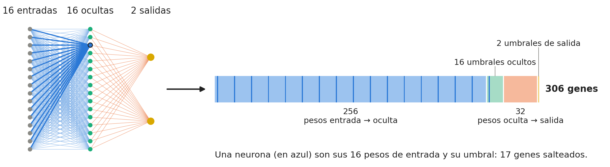
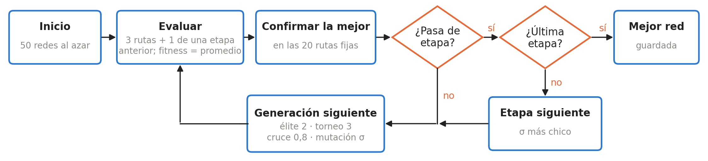
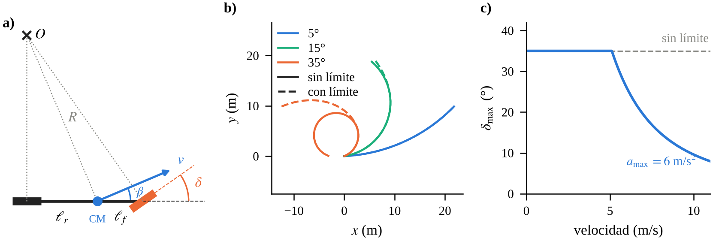

# La idea

## Conducción autónoma

:::: {.columns}
::: {.column width="50%"}
::: pregunta
¿Se le puede enseñar a un auto a manejar sin decirle cómo?
:::

Queremos que un auto vaya solo de **A** a **B** por calles reales de Santa Fe, sin salirse de la calle y por su carril.
:::
::: {.column width="50%"}
{width="88%"}
:::
::::

::: notes
**Decir:** Queremos que un auto vaya solo de A a B por calles reales de Santa Fe, por su carril y sin salirse. Nadie le enseña cómo: aprende probando. La red que maneja la entrena un algoritmo genético.
:::

# Antecedentes

## ¿Cómo se mueve un auto, con las cuentas más simples?

:::: {.columns}
::: {.column width="36%"}
{width="100%"}

::: cita
Kong et al. (2015), fig. 1
:::
:::
::: {.column width="64%"}
{width="100%"}

- **Al modelo entran** las dos decisiones de quien maneja: volante y aceleración
- **Del modelo sale** dónde queda el auto: posición, rumbo y velocidad. Desde ahí, quien maneja vuelve a mirar y decide de nuevo
:::
::::

::: chico
Modelo cinemático de bicicleta (Kong et al., 2015): $\dot x = v\cos(\psi+\beta)$, $\dot y = v\sin(\psi+\beta)$, $\dot\psi = \frac{v}{\ell_r}\sin\beta$, $\dot v = a$, con $\beta = \arctan\!\left(\frac{\ell_r}{\ell_f+\ell_r}\tan\delta\right)$.
:::

::: notes
**Decir:** Para mover el auto usamos el modelo de bicicleta: junta las dos ruedas de cada eje en una. Lo usamos como una caja. Entran el volante y la aceleración, que es lo que decide la red. Sale dónde está el auto, hacia dónde mira y a qué velocidad va. Las ecuaciones están abajo; no hace falta leerlas.

**Si preguntan:**

- ¿Por qué un modelo tan simple? Kong et al. (2015) lo comparan con datos de un auto real: predice casi tan bien como un modelo con neumáticos, con muchas menos cuentas.
:::

## ¿Qué se sabía antes de empezar?

:::: {.columns}
::: {.column width="34%"}
{width="100%"}

::: cita
Togelius y Lucas (2005), p. 1911
:::
:::
::: {.column width="66%" .preguntas}
**¿Se puede enseñar a manejar con un algoritmo evolutivo?**\
Sí, sin ejemplos: se elige la red que más avanza. [Togelius y Lucas, 2005, 2006]{.autor}

**¿Se puede entrenar una red con un genético?**\
Sí, con sus pesos en fila, como números reales. [Montana y Davis, 1989]{.autor}

**¿Cómo se cruzan y se mutan las redes?**\
Con cuidado: el orden de las neuronas importa. [Yao, 1999]{.autor}

**¿Qué fitness se le pone a un viaje?**\
Cuánto avanzó, no solo si llegó. [Nelson et al., 2009]{.autor}

**¿Cómo se aprende algo difícil?**\
De a poco, de lo fácil a lo difícil. [Gomez y Miikkulainen, 1996]{.autor}
:::
::::

**Pero todo esto en pistas de juguete: sin calles, sin carriles y sin esquinas.**

::: notes
**Decir:** Leer las cinco preguntas, una línea cada una. Cerrar con el "pero": todo esto se hizo en pistas de juguete con paredes. Calles, carriles y esquinas es lo que agregamos nosotros.

**Si preguntan:**

- Togelius y Lucas: una red con una capa oculta que ve la velocidad, las paredes y el próximo punto. Solo mutan, no cruzan. Entrenada en unas pistas, maneja en otras.
- Montana y Davis: entrenar la red con un genético les anduvo mejor que con retropropagación.
- Yao: la misma red con las neuronas en otro orden es otro cromosoma. Eso complica el cruce.
- Nelson et al.: si el fitness solo premia llegar, al principio todas sacan cero y no hay a quién elegir.
- Gomez y Miikkulainen: una tarea difícil se aprende mejor de a poco.
- Hay muchos más: Floreano y Mondada (1994), NEAT (Stanley y Miikkulainen, 2002), Koutník et al. (2013).
:::

# Lo que proponemos

## Nuestras seis propuestas

1. **Calles reales de Santa Fe:** rutas de A a B, por el carril derecho
2. **Una red que mira el carril** 3 y 6 m adelante, además de los bordes y el próximo punto
3. **Un fitness que premia avanzar por su carril**
4. **Comparar** cuatro formas de cruzar y dos de mutar
5. **Entrenar por etapas:** de una manzana a mapas cada vez más grandes
6. **Un límite de agarre,** para que maneje como puede un auto real

::: notes
**Decir:** Estas seis cosas son lo nuestro. Cada una tiene su diapositiva, con el mismo número. Leerlas rápido: el detalle viene después.
:::

## 1 · Calles reales, por su carril

{fig-align="center" width="48%"}

- **Calles reales de Santa Fe:** el camino más corto de A a B
- **Puntos de control** sobre el carril derecho
- **Un punto en cada giro,** para que no corte la esquina
- **Puntos que se pueden saltear,** para no quedar trabado

::: chico
Calles de OpenStreetMap, descargadas con OSMnx (Boeing, 2025). Camino más corto con A\* (Hart et al., 1968).
:::

::: notes
**Decir:** Las calles son reales, de OpenStreetMap. A\* busca el camino más corto de A a B. Sobre el carril derecho ponemos puntos de control: son lo que el auto tiene que ir pasando, y lo que mide el fitness. Hay un punto en cada giro, para que no corte la esquina. Y los puntos se pueden saltear, para que no quede trabado si se abre en un giro.

**Si preguntan:**

- ¿Por qué un punto en cada giro? Antes había uno cada 15 m, sin mirar la forma de la ruta. A veces la esquina quedaba entre dos puntos: el auto la cortaba y el fitness no se enteraba. Pasaba en el 11 % de los giros del 2×2, el 16 % del 3×3 y el 18 % del centro.
- Ahora hay un punto cada unos 10 m dentro de cada tramo, y uno en cada giro.
- Saltear: si alcanza uno de los 2 puntos siguientes al próximo, los que se salteó cuentan como pasados.
:::

## 2 · La red: qué ve y qué decide

:::: {.columns}
::: {.column width="38%"}
{width="70%"}
:::
::: {.column width="62%"}
{width="88%"}
:::
::::

- **16 entradas**, medidas desde el auto: 7 rayos al borde, velocidad, próximo punto, desvío del carril y el carril 3 y 6 m adelante
- **2 salidas**, las que entran a la caja del modelo del auto: volante = 35° · o₁; acelerador 2 m/s² · o₂ si o₂ > 0, freno 4 m/s² · o₂ si no

::: notes
**Decir:** La red ve 16 cosas, todas medidas desde el auto. 7 rayos miden la distancia al borde de la calle. Además ve su velocidad, hacia dónde y a qué distancia está el próximo punto, cuánto se desvió del carril, y hacia dónde va el carril 3 y 6 m adelante. Decide 2 cosas: el volante y la aceleración. Son las dos que entran a la caja del modelo del auto.

**Si preguntan:**

- 16 neuronas ocultas, con tangente hiperbólica.
- Mirar el carril adelante es nuestro: Togelius solo veía las paredes y el próximo punto.
:::

## 3 · El fitness: avanzar por su carril

$$
F_r = \frac{k_r + p_r}{K_r}\,\bigl(1 - c\,f_r\bigr)
$$

- **Avance:** los $k_r$ puntos de control pasados, más lo que avanzó hacia el siguiente ($p_r$), sobre el total $K_r$. Mide cuánto avanzó y no solo si llegó, porque al principio ninguna red llega y todas sacarían cero
- **Carril (lo nuestro):** se descuenta $c = 0{,}8$ por la fracción $f_r$ del tiempo que anduvo fuera de su carril

::: chico
El fitness de la red es el promedio de sus rutas. El viaje termina si llega, si se sale de la calle o si se acaba el tiempo ($t_{\max,r}$ = largo de la ruta / 4 m/s + 10 s).
:::

::: notes
**Decir:** El fitness mide cuánto avanzó por la ruta, de 0 a 1: llegar a B vale 1. Y le descuenta el tiempo que anduvo fuera de su carril. Mide cuánto avanzó, y no solo si llegó, porque al principio ninguna red llega. Si todas sacan cero, no hay a quién elegir.

**Si preguntan:**

- k: puntos de control pasados. p: cuánto avanzó hacia el siguiente. K: el total de puntos.
- f: la fracción del tiempo fuera de su carril. Se descuenta 0,8 y no 1, para que avanzar por la contramano valga algo más que quedarse quieto.
- No premia el tiempo: ir lento no le cuesta nada. Eso se ve en los resultados.
- El fitness de la red es el promedio de las rutas que manejó en esa generación.
:::

## 4 · Las opciones que comparamos

{fig-align="center" width="86%"}

::: {style="font-size:0.72em"}
| Operador | Qué hace |
|---|---|
| Cruce por neurona | Copia cada neurona entera (los 17 genes azules) de uno de los padres |
| Cruce por pesos | Copia cada peso del padre o de la madre, al azar |
| Cruce BLX-α | Sortea cada peso entre los de los padres, con el intervalo agrandado α = 0,5 |
| Sin cruce | El hijo es copia de un padre; solo cambia por la mutación |
| Mutación gaussiana | A cada peso, con probabilidad 0,05, le suma ruido normal de desvío σ |
| Mutación por neurona | Elige 2 neuronas y les suma ruido normal a sus 17 genes |
:::

::: chico
¿Por qué un genético? Para retropropagar hace falta el volante correcto en cada paso; nosotros solo tenemos un fitness al final del viaje.
:::

::: notes
**Decir:** El cromosoma es la red en fila: 306 números reales. En azul, una neurona: sus 16 pesos de entrada y su umbral, que en la fila quedan salteados. Comparamos cuatro formas de cruzar y dos de mutar. Usamos un genético porque no hay un volante correcto en cada paso para enseñarle: solo sabemos, al final del viaje, qué tan bien le fue.

**Si preguntan:**

- ¿Por qué comparar? La misma red con las neuronas en otro orden es otro cromosoma (Yao, 1999). Si se cruzan peso por peso, el hijo mezcla pedazos de neuronas distintas y puede no andar. Con 16 neuronas, la misma red se puede escribir de unas 1,4 · 10^18 formas.
- El cruce por neurona no arregla el orden, porque empareja las neuronas por posición. Solo evita desarmar cada neurona por dentro.
- Con probabilidad 0,2 no hay cruce, sea cual sea el tipo.
- Son 5 corridas, no todas las combinaciones: los cuatro cruces con mutación gaussiana, y cruce y mutación por neurona.
:::

## 5 · El algoritmo, etapa por etapa

{fig-align="center" width="100%"}

- **Para evolucionar, rutas al azar:** cada generación, las 50 redes manejan 3 rutas al azar de la etapa y 1 de una etapa anterior, para no olvidar. Con ese fitness se eligen los padres
- **Para elegir, rutas fijas:** con 3 rutas, una red puede tener suerte. Por eso la de mejor fitness se prueba en las rutas fijas de la etapa, siempre las mismas (20; 8 en la manzana)
- **Se guarda** si llega en más rutas fijas que la mejor hasta ahora. Con esas mismas rutas se decide cuándo pasar de etapa

::: notes
**Decir:** Arrancamos con 50 redes al azar. En cada generación, todas manejan unas pocas rutas al azar, y su fitness es el promedio. Con ese fitness se eligen los padres: élite, torneo, cruce y mutación. Pero con pocas rutas una red puede tener suerte. Por eso la ganadora de cada generación se reconfirma en rutas fijas, siempre las mismas. Con esas rutas fijas elegimos la mejor red y decidimos cuándo pasar de etapa.

**Si preguntan:**

- Rutas por generación: en la manzana, 2 vueltas, una para cada lado. Desde el 2×2, 3 rutas al azar y 1 de una etapa anterior, para que no se olvide.
- Rutas fijas: 8 en la manzana, que son todas las vueltas posibles (4 esquinas por 2 sentidos), y 20 en el 2×2 y el 3×3.
- Solo se reconfirma la ganadora: probar a las 50 en 20 rutas sería muy lento.
- La mejor guardada cambia si la nueva llega en más rutas fijas. Si empatan, gana la de mejor fitness, y después la más rápida. Además vuelve a la población, para no perderla.
- Élite de 2, torneo de 3, cruce con probabilidad 0,8 y mutación con el σ de la etapa.
:::

## 5 · Las etapas

De lo fácil a lo difícil: la población arranca en una manzana y sube a mapas más grandes, sin reiniciarse.

{fig-align="center" width="80%"}

| Etapa | σ de la mutación | Pasa si la mejor llega en (desde la generación 10) | Generaciones |
|---|---|---|---|
| Manzana (vueltas a la del medio) | 0,3 | todas las rutas fijas | de 10 a 100 |
| 2×2 | 0,2 | el 90 % | de 10 a 50 |
| 3×3 | 0,15 | (última etapa) | 50 |

::: notes
**Decir:** Aprender todo de una vez es difícil. Arrancamos fácil: una manzana. Cuando la mejor red da todas las vueltas, la población pasa al 2×2, y después al 3×3, sin empezar de cero. En cada etapa la mutación es más chica, para afinar lo aprendido sin desarmarlo.

**Si preguntan:**

- La idea es de Gomez y Miikkulainen (1996): evolución incremental.
- El centro no es una etapa: es para probar. Contiene a los recortes de entrenamiento, que son cerca del 22 % de sus calles. Por eso también probamos en barrios que no se usaron para nada.
:::

## 5 · Así se ve entrenar

<video data-autoplay loop muted playsinline src="img/entrenamiento.mp4" style="width:88%; display:block; margin:0 auto"></video>

::: chico
Las 50 redes de una generación manejan a la vez la misma ruta. En azul, la de mejor fitness.
:::

::: notes
**Decir:** Es una corrida real: la de cruce por neurona y mutación gaussiana. Las 50 redes de una generación manejan la misma ruta a la vez. En azul, la de mejor fitness; en gris, el resto; en rojo, las que chocan o se salen. En la manzana, al principio no llega ninguna; en la generación 62 algunas ya dan la vuelta. Después pasa al 2×2 y al 3×3, con rutas más largas.

**Si preguntan:**

- Mostramos solo algunas generaciones, cada una en una ruta distinta.
- Los autos están dibujados más grandes que en la realidad, para que se vean.
- Generaciones por etapa en esta corrida: 62 en la manzana, 10 en el 2×2 y 50 en el 3×3.
:::

## 6 · El límite de agarre

- **El problema:** la primera versión llegaba rápido a las esquinas y se salía. El modelo del auto deja doblar a fondo a cualquier velocidad
- **El límite:** $a_y = v^2/R \le 6$ m/s². A más velocidad, menos volante. No frena: frenar antes lo tiene que aprender la red

{fig-align="center" width="64%"}

::: chico
Trayectorias sin y con límite (b) y volante máximo según la velocidad (c): por debajo de 5,1 m/s dobla a fondo; a 8 m/s, no pasa de 14,9°.
:::

::: notes
**Decir:** La primera versión llegaba rápido a las esquinas y se salía. El problema: el modelo del auto deja doblar a fondo a cualquier velocidad, y eso ningún auto real lo puede hacer. Entonces pusimos un límite: la aceleración lateral no pasa de 6 m/s². A más velocidad, menos volante. El límite no frena: si llega rápido a la esquina, se sale. Frenar antes lo tiene que aprender la red.

**Si preguntan:**

- En un cruce de calles de 7 m, la curva más amplia tiene 17,9 m de radio doblando a la izquierda y 6,0 m a la derecha. Con 6 m/s², eso da unos 37 y 22 km/h. A 40 km/h no entra ninguna esquina.
- Por debajo de 5,1 m/s (18 km/h) dobla a fondo, hasta 35°. A 8 m/s no pasa de 14,9°.
- La cuenta: con el modelo de Kong, R = l_r / sen β, así que sen β_max = a_max · l_r / v².
:::

# Resultados

## Tres preguntas

1. **¿Qué hace la red si la física no la limita?** Sin límite de agarre contra con límite de 6 m/s².
2. **¿Importa el operador?** Cinco corridas: los cuatro cruces con mutación gaussiana, y cruce y mutación por neurona.
3. **¿Maneja en calles donde nunca entrenó?** En el centro y en seis barrios que no se usaron para entrenar.

::: chico
Seis corridas: las cinco de los operadores, con límite de agarre, y una sin límite. Una semilla. Se prueba con 20 rutas fijas, sin ruido en los sensores.
:::

::: notes
**Decir:** Tres preguntas, una por cada decisión. ¿Qué pasa sin el límite de agarre? ¿Importa el operador? ¿Maneja en calles que nunca vio?

**Si preguntan:**

- Una sola semilla por corrida.
- Se prueba sin ruido en los sensores, en las 20 rutas fijas del centro y en las de cada barrio.
:::

## P1: sin el límite, la red hace trampa

:::: {.columns}
::: {.column width="50%"}
<video data-autoplay loop muted playsinline src="img/manejo_sin.mp4" style="width:74%; display:block; margin:0 auto"></video>
:::
::: {.column width="50%"}
<video data-autoplay loop muted playsinline src="img/manejo_con.mp4" style="width:74%; display:block; margin:0 auto"></video>
:::
::::

::: {style="font-size:0.62em"}
| En el centro, 20 rutas | Llega | Tiempo medio | Velocidad cerca / lejos de un giro | Aceleración lateral máxima |
|---|---|---|---|---|
| Sin límite | 20 / 20 | 56 s | 40 / 37 km/h | **27,6 m/s²** (casi 3 g) |
| Con límite | 15 / 20 | 111 s | 19 / 18 km/h | **6,3 m/s²** |
:::

::: chico
Sin límite llega siempre y en la mitad del tiempo, porque aprovecha una física imposible. Misma ruta del centro, a 4× del tiempo real.
:::

::: notes
**Decir:** Es la primera vez que vemos un auto entrenado. Las dos redes son iguales: cambia solo el límite. Sin límite dobla a 40 km/h, con 27,6 m/s² de aceleración lateral: casi 3 g, un auto real se saldría. Por eso llega siempre y en la mitad del tiempo: hace trampa con la física. Con límite nunca pasa de 6,3 m/s². Pero va lenta todo el viaje, no solo en las esquinas: como el fitness no premia el tiempo, ir lento no le cuesta nada.

**Si preguntan:**

- La red aprende lo que el fitness le pide, y nada más. Para que frene antes de las esquinas habría que premiar llegar rápido: es lo que sigue.
- Las dos redes usan cruce por neurona y mutación gaussiana. El video va a 4× la velocidad real.
:::

## P2 y P3: operadores y calles nuevas

| Cruce | Mutación | Llega en el centro | Tiempo medio |
|---|---|---|---|
| por neurona | gaussiana | 15 / 20 | 111 s |
| por pesos | gaussiana | 20 / 20 | 142 s |
| BLX-α | gaussiana | 19 / 20 | 128 s |
| sin cruce | gaussiana | 19 / 20 | 135 s |
| por neurona | por neurona | 17 / 20 | 129 s |

- **P3:** todas aprendieron en la manzana, el 2×2 y el 3×3, y llegan en 15 a 20 de 20 rutas del centro, con diagonales, una avenida curva y cruces que no estaban en esos mapas
- **P2:** con una sola semilla, esas diferencias pueden ser suerte. Todos los operadores aprenden; para ordenarlos hacen falta más semillas

::: notes
**Decir:** Las cinco aprendieron solo en la manzana, el 2×2 y el 3×3. En el centro llegan en 15 a 20 de las 20 rutas. Y el centro tiene diagonales, una avenida curva y un cruce de siete calles que no estaban en esos mapas. Entre operadores hay diferencias, pero con una sola semilla pueden ser suerte.

**Si preguntan:**

- Para ordenar los operadores harían falta varias semillas por operador.
:::

## P2: las cinco, en la misma ruta

<video data-autoplay loop muted playsinline src="img/carrera.mp4" style="width:88%; display:block; margin:0 auto"></video>

::: chico
Una ruta del centro, de 826 m y 5 giros. Es un ejemplo: los números de la comparación están en la tabla.
:::

::: notes
**Decir:** Mismo mapa, misma ruta, y las cinco salen juntas. El cruce por neurona llega primero, en 159 s, pero es el que menos rutas termina en el centro: 15 de 20. El cruce por pesos llega último, en 202 s, pero termina las 20. Más rápido no es lo mismo que más seguro.

**Si preguntan:**

- Es un ejemplo: una ruta de 826 m con 5 giros, donde llegan las cinco y en el mismo orden que su tiempo medio.
- El video va a 6× la velocidad real.
:::

## P3: cada red en un barrio que nunca vio

<video data-autoplay loop muted playsinline src="img/comparaciones.mp4" style="width:76%; display:block; margin:0 auto"></video>

::: chico
Abajo de cada red, cómo le fue en las 20 rutas fijas de su barrio. Los barrios son distintos: para comparar operadores está la tabla del centro.
:::

::: notes
**Decir:** Cada red maneja en un barrio que no usó para nada: ni para entrenar ni para la prueba del centro. Abajo de cada una, en cuántas de las 20 rutas de su barrio llega: entre 7 y 20. Todas manejan en calles nuevas.

**Si preguntan:**

- Cada red está en un barrio distinto, así que este video no sirve para comparar operadores. Para eso está la tabla del centro.
:::

# Cierre

## Conclusiones

**Lo que propusimos:** entrenar por etapas, en calles reales, una red que maneja por su carril, con un límite de agarre que la obliga a manejar como un auto real.

1. Sin límite de agarre, la red aprovecha la física. Con el límite maneja dentro de lo posible, pero lento.
2. Todos los operadores aprenden; con una semilla no alcanza para ordenarlos.
3. Lo aprendido en recortes chicos sirve en el centro y en barrios que nunca vio.

::: chico
Lo que sigue: más semillas, premio por tiempo para que aprenda a frenar antes de las esquinas, tráfico y semáforos.
:::

::: notes
**Decir:** Propusimos entrenar por etapas, en calles reales, una red que maneja por su carril, con un límite de agarre. Tres cosas. Sin el límite, la red hace trampa con la física; con el límite maneja como un auto real, pero lento. Todos los operadores aprenden, pero con una semilla no podemos ordenarlos. Y lo aprendido en mapas chicos sirve en el centro y en barrios nuevos. Lo que sigue: más semillas, premiar llegar rápido, tráfico y semáforos.
:::
## Respaldo: los parámetros

| | Parámetro | Valor |
|---|---|---|
| Red | capas / desvío de pesos iniciales / ruido de sensores | 16 → 16 → 2 / 0,1 / 0,02 |
| Algoritmo genético | población / torneo / élite | 50 / 3 / 2 |
| | cruce / probabilidad | por neurona / 0,8 |
| | mutación / probabilidad por gen | gaussiana / 0,05 |
| | rutas por generación / fijas | 3 / 20 |
| Fitness | descuento por carril | 0,8 |
| Auto | límite de agarre | 6 m/s² |

::: notes
**Decir:** Solo si preguntan. Son los valores de todas las corridas; en las comparaciones cambia solo el cruce, la mutación o el límite de agarre.
:::
